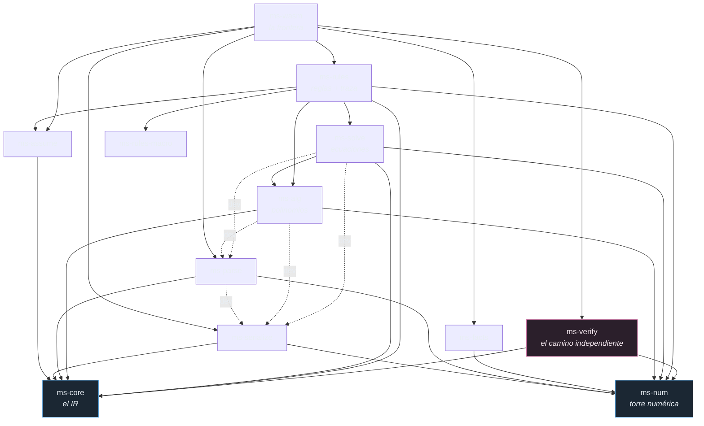

# Arquitectura del motor

> Qué se construye, cómo se divide y dónde están las fronteras que no se cruzan.
> Requisito previo: [`00-cas-internals.md`](00-cas-internals.md) (qué copiamos) y [`01-rust-principles.md`](01-rust-principles.md) (con qué lo construimos).

## Decisiones fijadas

| Decisión | Valor |
|---|---|
| Kernel | Propio, en Rust, desde el día 1. SymPy solo como oráculo en CI |
| Runtime | WASM en el navegador (Worker), sin servidor |
| Objetivo primario | **Pasos pedagógicos**, no amplitud de capacidades |
| Entrada | **LaTeX exclusivamente.** LLM después, como traductor a IR, nunca como calculadora |
| Salida | **Resultado normalizado semántico.** El motor no representa (§1) |
| Ubicación | `engine/` — módulo agnóstico, no conoce MathSlice |

La razón de fondo de elegir kernel propio **no es rendimiento**: es que SymPy no puede producir derivaciones paso a paso. En MathSlice el *cómo* vale más que el *qué*. Un motor que solo escupe la respuesta es una calculadora; uno que traza la derivación es material didáctico.

---

## 1. La frontera dura: el motor computa, no representa

**El motor produce un resultado normalizado del que se pueden derivar muchas representaciones. No produce ninguna.**

Esto separa dos responsabilidades que los sistemas de cálculo comerciales tienen fundidas — sus "pods" son cómputo *y* presentación a la vez:

```
  engine/ (Rust → WASM)                módulo de representación (TS)
  ─────────────────────                ──────────────────────────────
  "función real de una variable,       →  Desmos / Mafs      (graphEngine.ts)
   dominio ℝ∖{0}, polos simples        →  tabla de valores
   en x=0, asíntota y=1,               →  grafo / diagrama   (NodeDiagram.tsx)
   raíces {−2, 2}, paridad par,        →  escena de video    (MathCanvas)
   creciente en (0,∞)"                 →  prosa didáctica
```

El motor **no sabe que Desmos existe**. No emite configuración de gráfica, ni SVG, ni colores, ni viewport. Emite el hecho matemático. Quién decide que un polo se dibuja como asíntota punteada es la capa de arriba.

### Consecuencias concretas

- **No hay pod `plot`.** Hay `domain`, `singularities`, `asymptotes`, `roots`, `extrema`, `monotonicity` — hechos.
- **LaTeX es serialización, no representación.** El formato primario del wire es el árbol estructural (JSON); LaTeX va en paralelo para consumo directo. Ninguno de los dos elige tipografía, tamaño ni layout.
- **Un consumidor nuevo se enchufa sin tocar Rust.** El mismo `ResultDoc` que alimenta una gráfica de Desmos alimenta una escena de Motion Canvas para MathCanvas. Un sistema de cálculo comercial no puede hacer esto: sus pods ya vienen renderizados.

---

## 2. Crates

`engine/` es un **workspace Rust autocontenido y agnóstico**: no conoce Astro, ni React, ni el sitio.

```
engine/
├── Cargo.toml                     # workspace
├── architecture/                  # esta documentación
├── docs/                          # inventario de capacidades (main.md + 21 categorías)
├── lean/                          # proyecto Lean de soundness (ver 03-lean-verification.md)
├── corpus/                        # casos dorados extraídos del árbol
└── crates/
    ├── ms-core/      Expr IR: arena + ExprId(u32), hash-consing, atributos,
    │                 orden canónico, red de discriminación. Cero dependencias
    │                 matemáticas. Es el contrato que nunca debe cambiar.
    │
    ├── ms-num/       Torre numérica: Integer/Rational (malachite|rug), flotante
    │                 de precisión arbitraria, aritmética de bolas, algebraicos.
    │                 Exacto por defecto. Traits del principio §4.
    │
    ├── ms-parse/     LATEX → Expr. Solo LaTeX, subconjunto definido:
    │                 \frac \sqrt \int \sum \prod \lim \cdot ^ _ \left \right,
    │                 \sin \cos \tan \log \ln, \pi \infty \mathrm{d}x,
    │                 pmatrix/bmatrix, \{…\}. Pratt parser con precedencia y
    │                 multiplicación implícita. Errores con span sobre el LaTeX
    │                 original. NO acepta unicode matemático.
    │
    ├── ms-serialize/ Expr → JSON estructural (formato primario del wire) y
    │                 Expr → LaTeX (round-trip con ms-parse).
    │                 Serialización, NO representación.
    │
    ├── ms-rules/     Macro `rules!` + rule sets + TRACE. Cada regla lleva id,
    │                 patrón, resultado, guarda, nombre legible, plantilla de
    │                 paso, suposiciones requeridas y campo de soundness.
    │                 Compilado en build.rs a la red de discriminación.
    │
    ├── ms-assume/    Contexto de suposiciones tipado. Dominios, signos, cortes
    │                 de rama. Propagado por el evaluador.
    │
    ├── ms-simplify/  Formas canónicas de subdominio (expand/collect/together/
    │                 cancel) + capa de e-grafos (egg) con extracción por coste.
    │
    ├── ms-alg/       Polinomios densos/ralos, MCD modular, factorización
    │                 (Cantor–Zassenhaus + Hensel), resultantes, álgebra lineal
    │                 exacta; Gröbner más adelante. Todo genérico en C.
    │
    ├── ms-calc/      Derivadas, límites (Gruntz), series, integración
    │                 (tabla Rubi → heurísticas → Risch parcial), ODEs.
    │
    ├── ms-solve/     Ecuaciones y sistemas; raíces numéricas (Newton, secante,
    │                 bisección — el árbol de capacidades las pide explícitamente).
    │
    ├── ms-facts/     Extracción de HECHOS: dominio, ceros, polos, asíntotas,
    │                 extremos, monotonía, paridad, periodicidad, límites en ±∞,
    │                 discontinuidades. Cómputo puro, nada de dibujo.
    │                 EXISTE desde E1 con los hechos de un entero (signo,
    │                 paridad, primalidad, factorización, divisores); sólo
    │                 depende de ms-num hasta que E3 le traiga ms-core.
    │
    ├── ms-verify/    Verificación en 3 niveles. Produce Verified<T>.
    │
    ├── ms-query/     Despacho capacidad→handler. Mapea cada hoja del árbol a una
    │                 función y decide QUÉ hechos calcular (no cuáles mostrar).
    │
    ├── ms-wasm/      Frontera wasm-bindgen. API: solve(latex) → ResultDoc JSON.
    └── ms-cli/       REPL + arnés de corpus + comparador contra SymPy/Maxima.
```

### Regla de dependencias

- `ms-core` y `ms-num` **no dependen de nada** del workspace.
- Todo lo demás depende **hacia abajo**, nunca lateral.
- `ms-query` es el único que conoce el árbol de capacidades.
- **Ningún crate conoce ningún motor de dibujo.**

Verificado por `cargo-deny` + el test de frontera de §4.

Así está el grafo hoy, al cerrar E2. La lista de arriba dice la regla; esto dice
**si se cumple**, que es lo que cuesta ver leyendo trece `Cargo.toml`:



**La arista que no está es la que importa:** `ms-verify` no depende de
`ms-rules`, ni de `ms-alg`, ni de `ms-solve`. Comprobar un resultado con el
código que lo produjo no comprueba nada, así que el verificador reimplementa la
evaluación por su cuenta — y `deny.toml` lo hace cumplir, no un acuerdo entre
personas ([`03-lean-verification.md`](03-lean-verification.md)).

Las líneas discontinuas son **dependencias de test**. `ms-alg` y `ms-solve` las
tienen porque su puente con el IR se comprueba entrando por donde entra el
usuario —LaTeX— y saliendo por donde sale; y `ms-parse` la tiene porque
`parse(latex(e)) == e` exige los dos lados a la vez. Ningún build de producción
usa esas aristas.

### La división que importa

`ms-alg` vs `ms-simplify` no es una separación arbitraria: es la consecuencia directa del §5 de [`00-cas-internals.md`](00-cas-internals.md).

- **`ms-alg` = dominios con forma canónica.** Determinista, confluente, barato. Polinomios y funciones racionales.
- **`ms-simplify` = búsqueda.** Fuera de esos dominios no existe forma canónica computable (Richardson). Aquí van los e-grafos.

Meter búsqueda heurística dentro de `ms-alg` o pretender canonicidad en `ms-simplify` es el error clásico. `simplify()` de SymPy es precisamente esa caja negra sin contrato.

---

## 3. Contrato de salida: resultado normalizado, no presentación

Entra LaTeX, sale un documento **semántico**:

```jsonc
{
  "input": {
    "latex": "\\int x^{2}\\sin x\\,dx",
    "expr":  { "h": "Integrate", "a": [ /* árbol estructural */ ] }
  },
  "assumptions": [{ "var": "x", "domain": "Real" }],

  "result": {
    "type": "expression",      // | solution-set | number | matrix | interval | boolean | function
    "expr":  { /* árbol */ },
    "latex": "-x^{2}\\cos x + 2x\\sin x + 2\\cos x + C",
    "numeric": null            // si aplica: { center, radius, digits }
  },

  "alternates": [ { "expr": {…}, "latex": "…", "why": "collected" } ],

  "facts": [                   // hechos matemáticos; la UI decide qué hacer con ellos
    { "class": "domain",      "set": "Real" },
    { "class": "roots",       "values": [ /* exprs */ ] },
    { "class": "singularity", "at": {…}, "order": 1, "sided": "both" },
    { "class": "asymptote",   "direction": "+inf", "expr": {…} },
    { "class": "parity",      "value": "even" }
  ],

  "trace": [
    { "rule": "integration-by-parts",
      "title": "Integración por partes",
      "before": {…}, "after": {…},
      "bindings": { "u": {…}, "dv": {…} },
      "soundness": "lean:MeasureTheory.integral_mul_deriv_eq_deriv_mul" }
  ],

  "verification": { "level": 2, "status": "verified", "method": "differentiated-back" },
  "timing_ms": 12
}
```

**`facts` es lo que reemplaza al pod `plot` de un CAS comercial.** Si la consulta es graficable, el motor dice *qué es cierto de la función*; no dice cómo se ve.

> El discriminante es `class` y no `kind`, que es lo que decía este boceto: `kind` ya significa otras dos cosas en el mismo documento (`result.kind`, `error.kind`) y un tercer significado en el mismo JSON se lee mal. El campo entró en **E1 fase 3** con las cinco clases que el motor sabe emitir de verdad —`sign`, `parity`, `primality`, `factorization`, `divisors`—; las de arriba llegan con E3. La forma real está en [`../crates/ms-serialize/src/facts.rs`](../crates/ms-serialize/src/facts.rs) y su espejo `src/lib/engine/types.ts`.
>
> **La fase 4 añadió cinco clases más, y todas son formas de leer el mismo
> número:** `mixed`, `decimal`, `periodic`, `percent` y `place-value`. Que el
> campo admitiera clases nuevas sin cambiar el contrato es lo que hizo que
> quepan; que cada una diga *qué* y no *cómo* es lo que las mantiene del lado
> del motor. Los nombres de las posiciones —«decenas», «décimas»— **no** viajan:
> son idioma, y viven en la capa que dibuja (invariante 4).
>
> Dos de ellas son excluyentes por definición: un racional no entero tiene
> decimal finito o periódico según si su denominador conserva algún factor que
> no sea 2 o 5, nunca los dos. Emitir ambas sería una contradicción, no
> información de más.

### La capa de representación (TypeScript, fuera del motor)

```
src/lib/engine/
├── worker.ts         calca el patrón de src/lib/pyRunner.ts:
│                     worker perezoso, seq de ids, timeout, tipos
├── types.ts          ResultDoc, Fact, TraceStep — espejo del contrato
└── represent/
    ├── toGraph.ts    ResultDoc → config de graphEngine.ts (Desmos|Mafs)
    ├── toTable.ts    ResultDoc → tabla de valores
    ├── toSteps.ts    trace → pasos con LaTeX renderizable
    └── toDiagram.ts  ResultDoc → grafo (reusa NodeDiagram.tsx)
```

`toGraph.ts` es el **único** archivo del proyecto que sabe a la vez de matemáticas y de Desmos. `src/lib/graphEngine.ts` sigue siendo el switch de motor de dibujo, intacto.

Un consumidor futuro (MathCanvas → video) añade un `toScene.ts` aquí y no toca Rust.

---

## 4. Las cuatro invariantes

1. **Ninguna regla se dispara sin sus suposiciones satisfechas.**
   Impuesto por tipos ([`01-rust-principles.md`](01-rust-principles.md) §3), no por convención.

2. **Toda reescritura emite traza.**
   Lo silencioso se marca `#[silent]` explícitamente; el default es visible.

3. **Ningún resultado se muestra sin pasar por `ms-verify`.**
   La UI solo acepta `Verified<T>`. Si no se pudo verificar, sale **marcado** — no se oculta.

4. **Ningún crate menciona un motor de representación.**
   Test de CI:
   ```sh
   grep -ri "desmos\|mafs\|svg\|canvas\|viewport\|color" engine/crates/   # debe salir vacío
   ```

Las cuatro tienen verificación mecánica. Una regla de diseño que no se puede comprobar es solo una preferencia.

---

## 5. Toolchain

- **Cargo** y **wasm-pack**: instalados.
- Runner de tests: `cargo nextest run`. Perfilado de tamaño WASM: `twiggy`.
- Salida WASM a `src/lib/engine/pkg/`, cargada desde un Worker.
  > Estaba previsto `public/engine/`. Vive bajo `src/` porque así lo empaqueta
  > Vite: le pone hash al `.wasm` y lo sirve como un asset más, en vez de
  > copiarlo a mano a `public/` y arriesgar caché rancia. El directorio se ignora
  > en git; se regenera con `pnpm engine:build`.
- `cargo-deny` para los límites entre crates.
- `cargo-fuzz`, `criterion`, `proptest` — ver [`05-testing.md`](05-testing.md).
